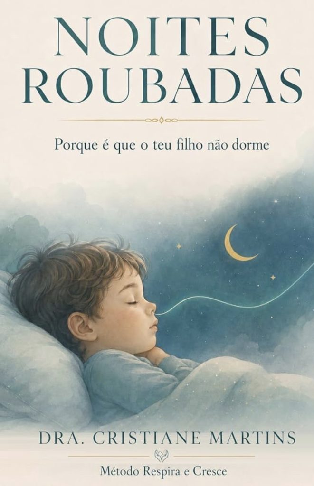

# Uma nova fase, celebrada em conjunto

Olá,

Hoje escrevo-lhe uma newsletter um pouco diferente. Senti vontade de partilhar consigo um momento que foi muito especial para mim e para toda a equipa da clínica.

Há encontros que nos fazem parar por um momento e olhar para o caminho que percorremos.

Recentemente, reunimos na clínica a nossa equipa e algumas das famílias que fazem parte desta história. Foi uma oportunidade especial para estarmos juntos fora da rotina das consultas, conversarmos com mais tempo e ouvirmos as experiências de quem nos acompanha.

Para nós, foi muito bom escutar as histórias, as lembranças e o que cada pessoa quis partilhar. Porque uma clínica faz-se de espaços e equipamentos, mas também das pessoas que cá trabalham e da confiança de quem entra pela porta.

Muitas famílias conheceram-nos quando os seus filhos eram pequenos. Vimo-los crescer, ouvimos as suas dúvidas e acompanhámos diferentes momentos das suas vidas. Com o tempo, nasceu também a vontade de continuar a recebê-los à medida que crescem e de acolher os adultos da família.

Esta nova fase da Kids & Family cresceu dessa vontade. E poder celebrá-la com pessoas que fazem parte do nosso percurso tornou o encontro ainda mais especial.

Houve outra razão para celebrar: o lançamento do meu livro, **Noites Roubadas: Porque é que o teu filho não dorme (e porque a culpa não é tua)**.

Antes de eu ter o livro nas mãos, recebi uma fotografia da equipa com os exemplares. Foi um daqueles momentos em que percebemos que um projeto pessoal também pode ser celebrado por quem caminha connosco todos os dias.

O livro nasceu do meu trabalho com as crianças e as suas famílias e da importância que a respiração ganhou no meu olhar sobre o seu crescimento. Em *Noites Roubadas*, convido os pais a olhar para o sono infantil por essa perspetiva, a conhecer alguns sinais a que podem prestar atenção e a compreender a que profissionais podem recorrer quando têm dúvidas.

É uma leitura para quem procura respostas com calma e sem culpa.

[Conhecer o livro Noites Roubadas](https://cristianemartins.pt/livros/)

À nossa equipa, obrigada pela dedicação e por crescer comigo. E a cada família que nos confiou os seus cuidados, obrigada por fazer parte desta história, tenha estado connosco neste encontro ou não.

Se quiser partilhar uma lembrança da clínica, deixar uma mensagem ou fazer uma pergunta sobre o livro, responda a este e-mail. Teremos muito gosto em ouvi-lo.

Cristiane Martins e equipa  
Clínica Kids & Family
